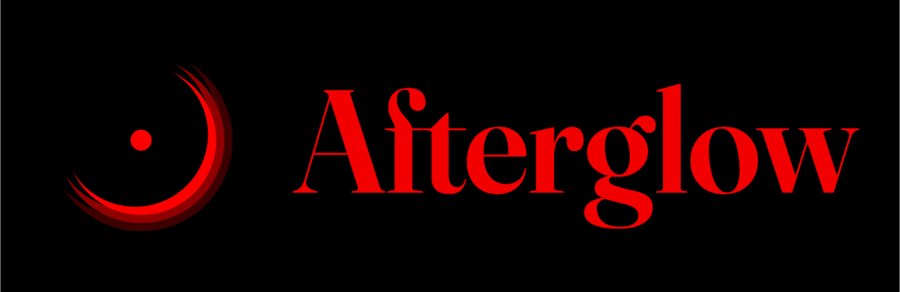
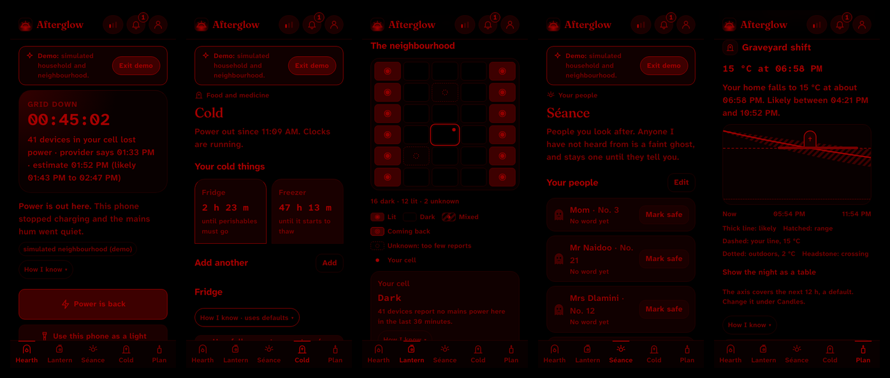
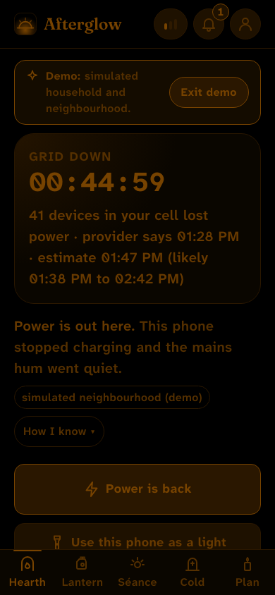

<p align="center">
  
</p>

<h3 align="center">The only app you can read when the grid dies.</h3>

<p align="center">
  <a href="https://afterglow-flax.vercel.app/?tour=1"><b>Take the tour with Wisp</b></a>
  ·
  <a href="https://afterglow-flax.vercel.app/?phase=outage&elapsed=45">Jump into a blackout</a>
  ·
  <a href="https://afterglow-flax.vercel.app">Website</a>
  ·
  <a href=".kiro/">The .kiro directory</a>
  ·
  <a href="docs/kiro/session-evidence.md">How it was built</a>
</p>

---

Between **1.5 billion** people (IFC, 2019) and **3.5 billion** (Ayaburi et al., 2020) live without reliable electricity, depending on where the reliability line is drawn. For them an outage is not news; it is Tuesday. Outage apps answer one question, *when will it come back?* Afterglow answers the ones people have **while they sit in the dark**:

- Is it just my house, or the whole street?
- Can I still eat what is in the fridge?
- How cold, or hot, will my home get tonight?
- Is my mother okay, when the network is down too?
- Is it safe to run the generator?

It is built for the real conditions: a mid-range phone, a dying battery, a pitch-black room and a congested network. So the whole interface is **red on pure black under a measured luminance ceiling**, checked pixel by pixel in CI. That keeps your night vision, does not light up the room and spends as little battery as possible. An amber variant serves people with red colour blindness.

<p align="center">
  
</p>

**Kiroween 2026 · Costume Contest.** In Afterglow every spooky element is a measurement:

| Costume | What it measures |
|---|---|
| **Tombstone** | A fridge or freezer. The epitaph is the time until the food must go, from USDA rules and a thermal model of *your* appliance. |
| **Ghost** | Someone you look after who has not been heard from since the outage began. They turn solid when they check in. |
| **Lantern map** | Where mains power still is, from phones and people in a ~1 km cell, shown only when at least 5 devices back it. |
| **Séance** | "I am safe" or "Help" sent as flashes of light from one phone's screen to another phone's camera. No network at all. |
| **Graveyard Shift** | Tonight's indoor temperature curve, with a headstone where your home crosses the danger line. |
| **Candle** | A battery: what it can keep running, in what order, for how long. |
| **Ward** | An unsafe action the app refuses, such as running a generator before the carbon-monoxide checks are confirmed. |
| **Wisp** | The guide: a small ghost who is scared of bright screens. Jokes, yes; numbers of its own, never. |

## For judges: one minute, no sign-up

1. Open **[the tour](https://afterglow-flax.vercel.app/?tour=1)**. Wisp turns off the lights and walks one night across all five tabs. Every number Wisp says is computed by the core for the screen you are on.
2. Or open **[a blackout in progress](https://afterglow-flax.vercel.app/?phase=outage&elapsed=45)**: a labelled demo household 45 minutes into an outage. Nothing is saved or sent.
3. **Hearth** shows the one line of truth and the clocks. **Cold** shows each food's verdict with its USDA rule. **Lantern** shows the neighbourhood; drag the playback to watch the night end. **Séance** has *Simulate a message*, which feeds a recorded signal through the real decoder (or point a second phone's camera at the screen). **Plan** draws the Graveyard Shift and the generator ward.
4. Tap **How I know** under any number to see where it came from.
5. Install it as an app from the browser menu, turn on flight mode, and open it again: everything above still works.

No account is needed. Accounts are real (see below) and free; any email works.

## Why it is different

- **It never guesses to look helpful.** Grid state, food discard time, hours of safety, the restoration estimate and every map cell come from deterministic, property-tested code with cited inputs. "Unknown" is a real answer, and the app says why it does not know.
- **The label is the law for medicine.** A medicine clock comes only from a pharmacist-signed entry in a separate formulary pipeline. No entry, no clock: the app says "ask your pharmacist" and shows the FDA's cited insulin guidance instead. The app ships with no signed table, and says so.
- **Privacy by construction.** Location leaves the phone only as a ~1 km cell. A cell is published only when at least 5 distinct devices back it, enforced in the core and again at the API. Camera and microphone data never leave memory.
- **Measured darkness, in two colours.** The same screens in amber (You → Colour) for people with red colour blindness, under the same ceilings and the same pixel scan.

  

- **Light as a radio.** The Heliograph sends short coded messages (Manchester coding, Hamming(12,8), CRC-4, two agreeing repeats) between a screen and a camera, through a window or across a courtyard. Property tests found that 3 of the 2,816 possible messages could never be read; that bug is fixed and documented.
- **AI phrases; it never decides.** The one runtime use of a model is optional: Claude on Amazon Bedrock may rephrase a guidance answer the offline library already chose, and a check throws the phrasing away if it contains any number the cited passages do not.

## What is real and what is simulated

**Real, deployed and tested**
- The deterministic core ([`packages/core`](packages/core/src)): events, cells and k-anonymity, schedules, thermal models, USDA FoodKeeper rules over all 661 products, formulary clocks, the energy planner, CO Guard, the Heliograph codec and receiver, restoration estimates, alerts and the guidance library.
- The Night Shell design system: luminance tokens in red and amber, and a pixel scanner that fails the build if any pixel on any screen exceeds its mode's ceiling.
- **Accounts on AWS** (`eu-central-1`): an email and one passphrase. The household is encrypted on the phone first (AES-256-GCM, PBKDF2 with 600,000 rounds), so AWS stores only ciphertext. API Gateway checks each request's Cognito token and the vault keys data only by the verified user id. Property tests prove isolation across thousands of interleaved requests, and a live check proved it against the deployed stack.
- **The public crowd API**: signed, rate-limited reports from phones (a 20-bit proof of work per device key per day), k-anonymous cells, outage history, places from OpenStreetMap, weather from Open-Meteo, push alerts when your area goes dark, and **Voice**: USSD menus and SMS replies for feature phones. OpenAPI description: [`apps/mobile/public/openapi.json`](apps/mobile/public/openapi.json).
- **Grid Sense in the browser**: the charger edge (Chromium and Android) and the mains hum through the microphone, on request. Where a browser cannot sense (iPhone Safari), the person's own "Power just went out" becomes a report, and still counts as only one device toward the five a cell needs.
- **Business and Beacon consoles**: cold-chain logs, a public "open and lit" status for shops and clinics, and area advisories for verified organisations.

**Simulated, and labelled as simulated in the app**
- The neighbourhood in the demo: a seeded simulation of about 900 devices whose reports go through the real k-anonymity code. The live map is real, and empty until five devices in a cell report.
- The demo household and its outage.

**Not built yet**
- Native Android and iOS apps, with background sensing, the phone torch and Bluetooth relay. In the browser the app says "unknown" rather than pretend to sense.
- A signed medicine table: it needs a licensed pharmacist, which a hackathon cannot supply. The pipeline that will hold it is built and tested.
- Utility schedule providers. A manual schedule works; no provider is connected yet.

## How it was built: Kiro, then Claude Code

Afterglow was built in **Kiro** from 3 to 25 November 2026: 7 sessions, 1,190 tool calls and 1,162 hook runs, recorded in Kiro's own session logs. That period produced the core, the design system and pixel scan, the five tabs, the formulary pipeline, the simulator, the Terraform foundation, and all of the steering, hooks, agents and skills.

On 25 November the Kiro credits ran out. From 26 November the work continued in **Claude Code**, following the same steering, specs, hooks and definition of done: the guide, alerts, the AWS account service and crowd API, Voice, the consoles, the website, the hook fixes and tests, the MCP server and Power, and the amber variant. About 40,900 lines were written in the Kiro period and about 26,300 after it. [`docs/kiro/session-evidence.md`](docs/kiro/session-evidence.md) lists which module was built where, with the counts and the method, including what Kiro's logs do *not* show.

### The Kiro surface

**Specs: [29 modules](.kiro/specs).** EARS requirements with ids such as `HL-07` or `CE-03`, a `tasks.md` of numbered tasks that cite them, and a `design.md` where the module needed one. [`kiro-guardrails`](.kiro/specs/kiro-guardrails) is a bugfix spec in Kiro's format (current, expected and unchanged behaviour). Requirement ids are unique across specs and appear in the names of the tests that prove them, so `grep HL-07` shows the requirement, the task and the test together.

**Steering: [11 files](.kiro/steering), all four inclusion modes.** Four safety invariants are always included: [`fail-closed`](.kiro/steering/fail-closed.md), [`privacy-aggregation`](.kiro/steering/privacy-aggregation.md), [`night-vision`](.kiro/steering/night-vision.md) and [`label-only-medicine`](.kiro/steering/label-only-medicine.md), with `product`, `tech` and `structure`. [`terraform-regions`](.kiro/steering/terraform-regions.md) loads only for `infra/**` (fileMatch). The architecture and product documents load only when a request is about them (`auto`), which keeps about 140 KB out of every turn. [`release-checklist`](.kiro/steering/release-checklist.md) is manual. [`AGENTS.md`](AGENTS.md) is the short contract every agent reads.

**Hooks: [13](.kiro/hooks), mostly guardrails that block.** In the Kiro sessions they ran 1,162 times. Because a guardrail that never fires proves nothing, [`tools/kiro-guardrails`](tools/kiro-guardrails) runs every hook's real command the way Kiro does (project root, the documented event JSON on stdin) against inputs it must block and inputs it must allow: 68 tests, two of them fast-check properties. Writing those tests found three real defects in hooks Kiro itself had generated: timeouts in a field Kiro ignores, a variable Kiro never sets, and shell matchers that missed the IDE's process tool. See the [bugfix spec](.kiro/specs/kiro-guardrails/bugfix.md).

| Hook | Trigger | What it does |
|---|---|---|
| [Agent stop gate](.kiro/hooks/agent-stop-gate.json) | Stop | Returns a block decision while any property test is red, so the agent takes another turn. |
| [Deny dialers](.kiro/hooks/deny-dialers.json) (+ [MCP](.kiro/hooks/deny-dialers-mcp.json)) | PreToolUse | Blocks anything that could text, call or push a real person. |
| [Deny formulary write](.kiro/hooks/deny-formulary-write.json) (+ [shell](.kiro/hooks/deny-formulary-write-shell.json)) | PreToolUse | No agent can write the validated medicine table; only the pharmacist pipeline can. |
| [Deny publish and deploy](.kiro/hooks/deny-publish-deploy.json) | PreToolUse | Blocks `npm publish`, `eas submit`, `terraform apply`, even chained after harmless commands. |
| [Luminance on token save](.kiro/hooks/luminance-on-token-save.json) | PostFileSave | Re-checks every colour token against the night-vision ceilings. |
| [Sensing fixtures on save](.kiro/hooks/sensing-fixtures-on-save.json) | PostFileSave | Re-runs the sense-fusion properties when fusion code changes. |
| [Property skeleton on create](.kiro/hooks/property-skeleton-on-create.json) | PostFileCreate | A new core file gets a property-test skeleton, named with its spec's ids. |
| [Post-task verify](.kiro/hooks/post-task-verify.json) | PostTaskExec | After a spec task: typecheck, lint, every property suite, and the pixel scan. |
| [Prompt context and secret scan](.kiro/hooks/prompt-context.json) | UserPromptSubmit | Adds shared vocabulary and refuses prompts that contain secrets (IDE). |
| [Session brief](.kiro/hooks/session-brief.json) | SessionStart | Briefs the agent on the latest property-test catches, open human gates and uncommitted work. |
| [Formulary docs regen](.kiro/hooks/formulary-docs-regen.json) | PostFileSave | Regenerates the public formulary docs from the approved table. |

**Custom agents: [8](.kiro/agents), each with scoped tools and write paths.** The [Label Reader](.kiro/agents/label-reader.json) may write only to `afterglow-formulary/proposals/`; a headless `kiro-cli` run confirmed that its own permission rule, not the model's judgement, refused a write outside that folder ([experiment E3](docs/kiro/experiments.md)). The [Pharmacist Validator](.kiro/agents/pharmacist-validator.json) is configured to run on a different model vendor (OpenAI) from the Label Reader (Anthropic), so one model's blind spot cannot approve itself. [Night Watch](.kiro/agents/night-watch.json) is a read-only reviewer that can call the MCP luminance tools. Two of the eight agents have been run; the others are configured and validated with `kiro-cli agent validate`.

**MCP: [the Afterglow MCP server](tools/mcp-server), configured in [`.kiro/settings/mcp.json`](.kiro/settings/mcp.json).** It gives an agent the project's own deterministic tools: check colours or a whole token file against the luminance ceilings, pixel-scan a screenshot, get a USDA food verdict, and encode a Heliograph frame. A reviewer can check a design change with the same maths the build gate uses. Every tool is read-only and refuses paths outside the workspace; 35 tests include a real stdio session. Run `pnpm build` once so Kiro can start it; `kiro-cli mcp list` then shows it. It was added after the credits ran out, so it has not yet been used inside a Kiro session.

**Powers: [Night Vision](powers/night-vision).** The luminance gate, packaged so any other project can adopt it: a skill that teaches an agent to keep a UI under a brightness ceiling, the rules as a steering file to copy in, and a self-contained MCP server with the luminance tools. It installs with `kiro-cli powers install powers/night-vision`.

**Skills: [4](.kiro/skills)**: EARS authoring, property-test authoring, formulary review and Kiro evidence.

**Property-based testing is the definition of done.** [`docs/kiro/pbt-catches.md`](docs/kiro/pbt-catches.md) records every real bug a property, the pixel scan or an integration test found that example tests missed, each with its shrunk counterexample. One example: back-to-back Heliograph repeats spelled a false frame, so three messages could not be read at all. Another: the guide's fade blended one step over the night-vision ceiling, caught by the pixel scan.

**Experiments, including the inconclusive ones**, are in [`docs/kiro/experiments.md`](docs/kiro/experiments.md).

## Architecture

```
apps/mobile             web PWA: public site, sign-in, and the app (/app): Hearth, Lantern, Séance, Cold, Plan
  └─ packages/adapters    WebCrypto vault, signed-formulary loader, Heliograph camera and screen lamp
       └─ packages/core     pure TypeScript: no I/O, no timers, no randomness; runs in Node and the browser
packages/design-system  Night Shell tokens (red and amber), luminance maths, pixel scanner
services/vault          zero-knowledge vault API (Lambda, Cognito JWT authorizer)
services/crowd          public crowd API: reports, cells, history, places, weather, Ask, USSD and SMS
services/console        Business and Beacon consoles
afterglow-formulary     proposal → review → approval → Ed25519-signed snapshot (no drug data yet)
afterglow-crew          Python checks runner and regression triage for a planned Kiro Crew app
tools/simulator         the seeded neighbourhood behind the demo and the tests
tools/kiro-guardrails   runs every Kiro hook against inputs it must block and allow
tools/mcp-server        the Afterglow MCP server
powers/night-vision     the luminance gate as a reusable Kiro Power
infra                   Terraform: bootstrap and regional stacks (KMS, S3, DynamoDB, Cognito, API Gateway, Lambda, alarms)
```

Dependencies point one way: UI → feature modules → core → adapters → OS. The full design is in [`docs/afterglow-architecture.md`](docs/afterglow-architecture.md), the UI and UX in [`docs/afterglow-design.md`](docs/afterglow-design.md), and the product in [`docs/afterglow-project-description.md`](docs/afterglow-project-description.md). Those three documents were written on 3 November, before the first Kiro session, and the specs were written from them.

## Run it

Requires Node 22+ and pnpm 9.

```bash
pnpm install
pnpm --filter @afterglow/mobile dev      # http://localhost:5173
pnpm test                                # every unit and property suite
pnpm typecheck && pnpm lint
pnpm --filter @afterglow/mobile e2e      # Playwright, including the pixel scan
```

Every check below passes on the current commit (2026-11-27):

| Suite | Tests |
|---|---|
| TypeScript unit and property tests (`pnpm test`, 12 packages) | 858 |
| Playwright browser tests, including the pixel scan of every screen in three modes and two colours | 239 |
| Python property tests (`afterglow-crew`, Hypothesis) | 95 |
| Terraform tests (offline plans of the stacks and modules) | 69 |

CI runs lint, typecheck, the property suites (in Node and in headless Chromium), the build and the pixel scan on every push.

## Sources

- IFC (2019), *The Dirty Footprint of the Broken Grid*: "About 1.5 billion people around the world live day-to-day with 'broken' electricity grids."
- Ayaburi, Bazilian, Kincer and Moss (2020), "Measuring 'Reasonably Reliable' access to electricity services", *The Electricity Journal* 33(7): over 3.5 billion people without reliable electricity, counting those with no connection at all.
- USDA FoodKeeper (CC0) and USDA FSIS outage guidance; CDC and US CPSC carbon-monoxide guidance; FDA insulin storage guidance; NREL ResStock building archetypes; Open-Meteo; OpenStreetMap.

## Not an emergency service

Afterglow never replaces your local emergency number and is not a medical device. It gives label-derived information with its sources, not a diagnosis.

## License

[Apache-2.0](LICENSE). Food safety data: USDA FoodKeeper (CC0).
