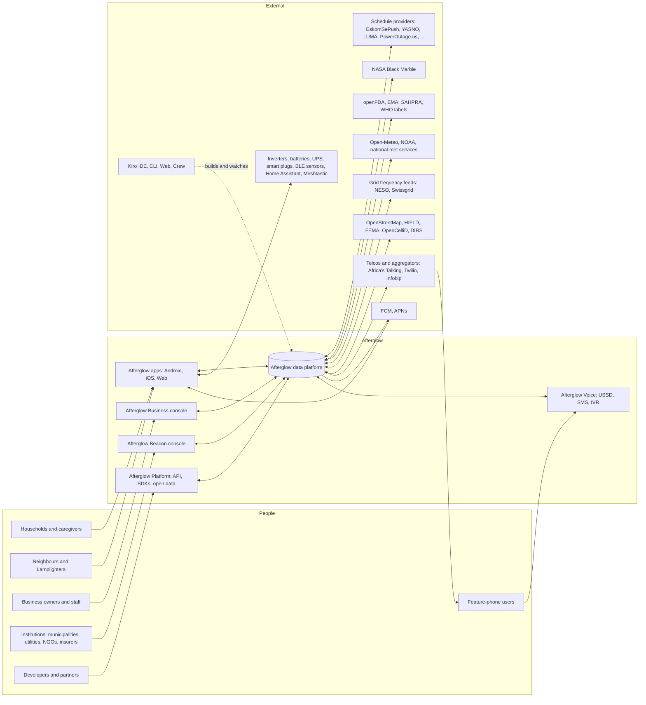
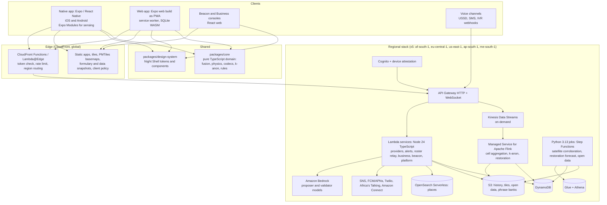
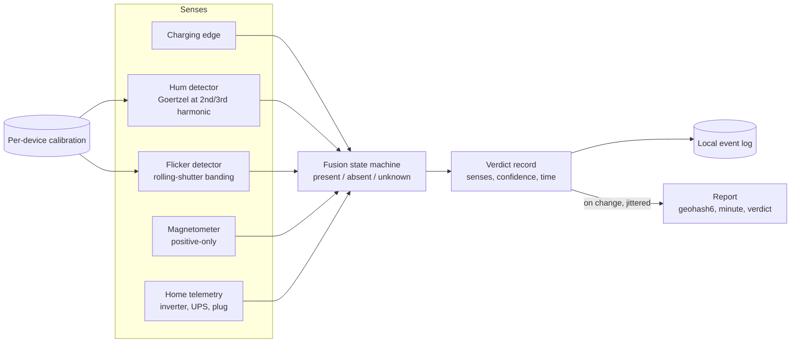
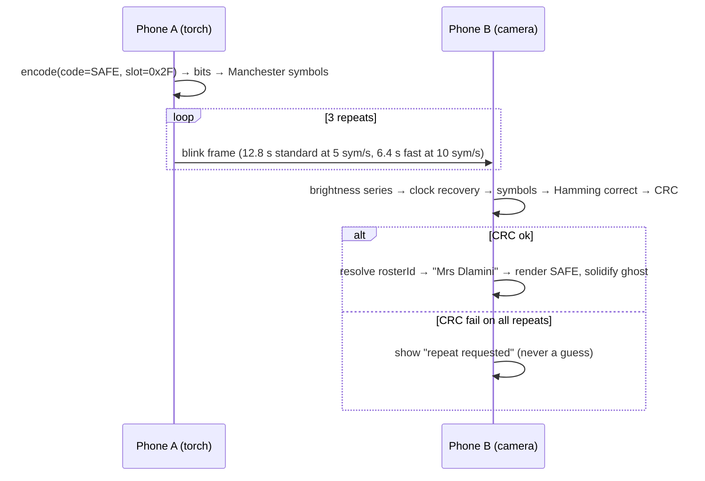
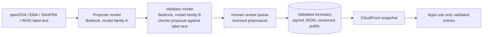
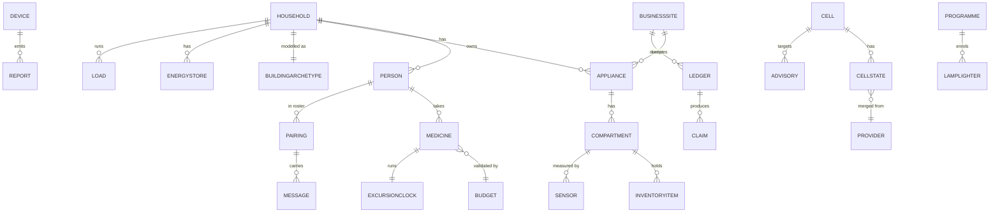

# Afterglow — Architecture and Technology Stack

**Companion to:** `afterglow-project-description.md` (what the product is) · `kiroween-2026-recon.md` (hackathon rules).
**Scope of this document:** the architecture and the technology choices that the implementation will follow: structure, boundaries, protocols, data, infrastructure, security, operations and the reasoning behind each choice. It does not sequence the work; that belongs to the implementation plan.
**Conventions:** **[my call]** marks a decision made by the author that the founder may override. ADR-nnn refers to the decision records in section 17. Versions are those current in November 2026 and are pinned in the repository, not here.

---

## Table of contents

1. Architecture principles and quality attributes
2. System context
3. Container view
4. Client architecture
5. Sensing architecture (Grid Sense)
6. Heliograph protocol stack
7. Physics engines
8. Backend architecture
9. AI architecture and boundaries
10. Data architecture
11. Security and privacy architecture
12. Observability and operations
13. Integration architecture
14. Development platform and delivery
15. Kiro-native engineering architecture (Technological Implementation)
16. Technology stack summary
17. Architecture decision records
18. Capacity and cost model
19. Open technical risks

---

## 1. Architecture principles and quality attributes

### 1.1 Principles (derived from the product specification)
1. **Deterministic core, isolated.** All verdict logic lives in a pure TypeScript package with no I/O, shared byte-for-byte between every client and server. AI, networks and sensors are adapters around it.
2. **Fail closed at every boundary.** Unknown is a legal output of every function that can be unsure. Aggregation refuses to publish below k. Clocks refuse to exceed their source.
3. **Local first.** Every model runs on the device against local data; the network is an accelerator, never a dependency.
4. **Privacy by construction.** The system is designed so that the data regulators worry about is never created: raw media stays in RAM, location leaves the device only as a cell, roster payloads are ciphertext.
5. **Burst-proof.** The defining load event is a metro going dark at once. The architecture accepts, buffers and serves from cache before it computes.
6. **One core, many surfaces.** Native apps, web app, Voice, Business, Beacon and Platform are shells over the same core, design tokens and data platform.
7. **Verifiable.** Every requirement in the specs maps to a property-based test; every hook that guards a dangerous tool is part of the architecture, not of the process.

### 1.2 Quality attributes (targets, measured)
| Attribute | Target |
|---|---|
| Availability (tiles, alerts, Voice) | 99.95% monthly, per region |
| Burst ingest | 50,000 reports/s sustained for 10 minutes; one million devices in one metro within five minutes |
| Freshness | cell state visible to clients ≤ 60 s after the window closes; restoration alert ≤ 60 s after detection |
| Client performance | cold start ≤ 2 s on a 2019 mid-range Android; ≤ 150 MB RAM; sensing cycle ≤ 3 s; red UI ≤ 1 lux at 30 cm |
| Offline | 100% of safety modules function with no connectivity for 7 days on cached data |
| Privacy | 0 raw media bytes leave a device; 0 published cells with < 5 devices; per-device reports retained ≤ 30 days |
| Portability | one TypeScript core running identically on Hermes (native), V8/JSC (web) and Node (server), verified by the same property suite |
| Cost | ≤ $0.03 per monthly active user per month at 10M MAU (section 18) |

## 2. System context



External dependencies are all optional at runtime for the safety modules: the app degrades to local sensing and cached data when any of them is unreachable.

## 3. Container view



## 4. Client architecture

### 4.1 One codebase, three targets **[my call, ADR-001]**
A single Expo application (Expo SDK 57, SDK 56 minimum; React Native 0.85+ on the New Architecture with Hermes; React 19.2; Expo Router) builds the iOS app, the Android app and the web app. The web build is the installable PWA (service worker via Workbox, web manifest, offline shell). Platform differences are confined to adapter modules selected at build time by file suffix (`.native.ts`, `.web.ts`, `.android.ts`, `.ios.ts`). Web-only libraries that have no native equivalent (none required today) would be hosted in Expo DOM components rather than forking the UI.

Alternatives considered: separate React web app plus React Native app (double UI, drift); Kotlin Multiplatform + Compose (strong natively, weak web story, no Kiro TypeScript PBT path); Flutter (good, but the deterministic core must then be Dart and cannot be shared with the Node services).

### 4.2 Layering
```
UI (Expo Router screens, Night Shell components)
  → Feature modules (grid-sense, ember-map, heliograph, cold-chain, medicine, hours-of-safety, candles, co-guard, lamplighters, signal, services, alerts, household, business, guidance, history, onboarding)
    → Domain core (packages/core: pure, deterministic, property-tested)
      → Platform adapters (sensing, storage, network, crypto, maps, notifications, background)
        → OS and browser APIs, Expo Modules (Kotlin/Swift), native libraries
```
Dependencies point downward only. Feature modules never import OS APIs directly; they import adapter interfaces. The core imports nothing but itself.

### 4.3 Domain core (`packages/core`)
Pure TypeScript, no I/O, no timers, no randomness except injected generators. Modules: `fusion` (sense votes → verdict), `cells` (geohash-6, k-anonymity aggregation, restoration detector), `schedule` (provider merge, adherence), `thermal` (RC models for compartments and buildings), `foodkeeper` (rules engine over the snapshot), `formulary` (excursion clocks over validated entries), `energy` (store/load planner), `heliograph` (frame encoder/decoder, FEC, symbol timing recovery on sampled brightness series), `acoustic` (ggwave payload adapter), `alerts` (rule evaluation), `events` (append-only event log types and reducers), `policy` (storm-mode client policy evaluation). Each module ships its property tests next to it; the same suite runs on Hermes, in the browser and on Node in CI (ADR-002).

### 4.4 Platform adapters (capability matrix)
| Capability | Android | iOS | Web |
|---|---|---|---|
| Charging edge | Expo Module: runtime-registered receiver for ACTION_POWER_CONNECTED/DISCONNECTED inside an opt-in foreground service ("Sentinel"); WorkManager job with the charging constraint as the restoration signal; BatteryManager polling fallback | Foreground only (UIDevice battery state); BGTaskScheduler refresh; no reliable background disconnect event, stated in the UI | Battery Status API (Chrome Android); unavailable on Safari |
| Mains hum | AudioRecord, `UNPROCESSED` source, 48 kHz mono PCM | AVAudioEngine, measurement mode, 48 kHz | Web Audio: `getUserMedia` with echo cancellation, noise suppression and AGC disabled; AudioWorklet |
| Light flicker | VisionCamera v5 frame processor (worklets, Nitro) | VisionCamera v5 | `getUserMedia` → `OffscreenCanvas`/WebGL readback |
| Magnetometer | expo-sensors at the maximum OS rate | expo-sensors | not available (Generic Sensor API not broadly shipped) |
| Ambient light | OS sensor | OS sensor (via screen brightness heuristics) | camera-based estimate; manual toggle |
| Torch | expo-camera / VisionCamera torch | same | `ImageCapture` torch constraint (Chrome Android); screen-as-lamp fallback |
| Camera frames (Heliograph RX) | VisionCamera frame processor → brightness series | same | `getUserMedia` + `requestVideoFrameCallback` |
| Acoustic (ggwave) | native wrapper of the C++ library (Expo Module) | same | ggwave WASM + Web Audio |
| BLE advertise/scan | BluetoothLeAdvertiser + scanner (Expo Module) | CoreBluetooth peripheral and central (background with limits) | central-only Web Bluetooth; not used for roster |
| Local high-bandwidth | Wi-Fi Aware (Android 8+) | Multipeer Connectivity | not available |
| Background execution | Sentinel foreground service (opt-in), WorkManager | BGTaskScheduler, silent push wake | service worker + Periodic Background Sync where granted |
| Widgets | App widgets (Glance) | WidgetKit, Live Activities | none |
| Push | FCM | APNs | Web Push |
| Secure storage | Keystore | Secure Enclave / Keychain | WebCrypto non-extractable keys + IndexedDB |

### 4.5 Local data and sync **[ADR-003]**
- **SQLite everywhere**: `expo-sqlite` on native (SQLCipher-encrypted where the OS keystore holds the key), `wa-sqlite` on OPFS in the browser. One schema, one query layer.
- **Append-only event log + materialised views**: every user action and sensing verdict is an event with `(deviceEpoch, lamport, type, payload)`; views (appliances, clocks, roster, reports) are reducers over the log, so replays, undo and audit are free and the same reducers run server-side.
- **Sync**: idempotent batches of events, jittered 0–120 s (longer under storm policy), acknowledged by server watermark; conflicts resolved per entity by last-writer-wins with device-epoch ordering, except roster messages (append-only) and reports (immutable). No sync is required for any safety function.
- **Snapshots cached on device**: FoodKeeper, validated formulary, archetype tables, device table, provider schedules, city map packs (PMTiles extracts, ≤ 50 MB per city), phrase banks for Voice are server-side only.

### 4.6 Background execution model
Android: the opt-in **Sentinel** foreground service holds the runtime-registered power receiver and a low-rate BLE scan; a persistent notification explains it; WorkManager runs restoration checks under the charging constraint and periodic sync. iOS: BGAppRefresh and BGProcessing tasks, silent pushes to wake for cell-state changes, and home telemetry (inverter cloud webhooks → push) as the authoritative background signal; the UI states these limits. Web: service worker for caching and push; sensing only while the page is open.

### 4.7 Night Shell rendering
Design tokens are the single source of colour (`theme.night.json`, three luminance modes: Night ceiling L 8%, Dusk 10%, Ember 19%); components consume semantic tokens only; a lint rule and a Playwright pixel-scan property enforce that no rendered pixel exceeds the active mode's ceiling. Brightness capping uses `expo-brightness` on native; on web the shell dims via a full-screen overlay since browsers cannot set hardware brightness.

### 4.8 Maps
MapLibre on all targets (`maplibre-react-native` on native, MapLibre GL JS on web) with Protomaps PMTiles basemaps self-hosted on S3 behind CloudFront, offline city packs, and Afterglow's cell overlay delivered as vector tiles (section 8.4). Dark basemap style derived from the Night Shell tokens.

## 5. Sensing architecture (Grid Sense)



- **Hum detector**: 2 s of 48 kHz mono PCM captured with processing disabled; a Goertzel bank at the 2nd and 3rd harmonics of the regional mains frequency with ±1 Hz tolerance (grid frequency drifts), compared with the median noise floor across 80–200 Hz excluding the target bins; thresholds come from onboarding calibration (two reference samples) and adapt slowly. Output present/absent/unknown with an SNR confidence. Runs in the shared core on a `Float32Array`; the adapters only capture audio.
- **Flicker detector**: 1 s of frames at the camera's maximum rate on a lit surface; mains-driven lighting at 100/120 Hz produces rolling-shutter banding whose spatial period relates the flicker frequency to the sensor readout time; the detector takes row means, finds the dominant spatial frequency, and checks it against the readout time reported by the camera adapter (or a calibration table). Positive-only: absence proves nothing.
- **Magnetometer**: positive-only detection of a 50/60 Hz field where the OS sample rate permits (aliasing-aware); otherwise disabled.
- **Home telemetry**: inverter cloud APIs (OAuth), local Modbus/MQTT via Home Assistant, UPS via Network UPS Tools, smart plugs via Matter. A grid-loss event from the home's own equipment is authoritative for that home and reported with high confidence.
- **Fusion**: a pure function over the current sense votes and the k-corroboration count (from the last known cell state) producing the verdict and the list of senses that voted. Rules as in the specification: present on any positive without contradiction; absent only on two negatives, or one negative with ≥k neighbours or telemetry; unknown otherwise. Order-independent and property-tested.
- **Privacy guarantees**: capture buffers are allocated, processed and zeroed in the same call; no sensing adapter has a persistence dependency; the verdict record contains no media.

## 6. Heliograph protocol stack

| Layer | Optical | Acoustic | BLE | Local high-bandwidth | SMS / voice |
|---|---|---|---|---|---|
| Physical | torch or screen, on-off keying, Manchester-coded for clock recovery; two profiles: **standard** 5 symbols/s (12.8 s per 32-bit frame, any camera) and **fast** 10 symbols/s (6.4 s per frame, camera ≥ 40 fps); the receiver picks by measured frame rate | ggwave multi-frequency FSK, audible or near-ultrasonic, 8–16 bytes/s | advertising payloads (≤ 31 bytes legacy, extended where available) | Wi-Fi Aware / Multipeer Connectivity | carrier SMS, IVR |
| Link | frame = preamble (8) · two Hamming(12,8) words carrying sequence (2) · code (4) · slot (6) · CRC-4 (32 bits in all); three repeats; a message is shown only when two repeats agree (or three vote), otherwise "repeat requested" | ggwave's own framing and ECC | frame in manufacturer data; store-and-forward with TTL and dedup | TLS-like session, full roster snapshot | code text with roster id |
| Application | message code + roster slot (0–63, pair-local) → "Mrs Dlamini: SAFE" | same | same plus relay | same plus map snapshot | same |
| Security | codes are intentionally public (light is visible); roster ids are pair-local and rotate daily from a shared secret | same | same | end-to-end encrypted with pair keys (libsodium) | end-to-end encrypted text where both ends run the app; plain code otherwise |



The receiver pipeline: per-frame luminance of candidate blobs (temporal differencing selects blinking regions; the brightest periodic blob is tracked), a brightness series resampled to symbol rate, Manchester clock recovery tolerant to ±20% frame-rate jitter, then decoding in the shared core (`packages/core/src/heliograph`, spec `.kiro/specs/heliograph`). The same decoder is fed recorded fixtures in CI.

## 7. Physics engines

- **Compartment model**: `T(t) = T_amb + (T_0 − T_amb)·e^(−t/τ)`, τ by appliance class and fullness, anchored to USDA guidance and refined by the household's events; door-open events add a step proportional to open time; ice load lengthens τ; sensors override the model when present. The engine exposes `temperatureAt(t)`, `crossingTime(threshold)` and `discardTimes(inventory)`; all pure.
- **Building model**: the same first-order form with τ from archetype tables (NREL ResStock and regional libraries), driven by the hourly forecast series; internal gains as a constant offset; outputs the crossing time and an uncertainty band from the archetype's τ range.
- **Excursion clocks**: integrate budget consumption only while the compartment or room temperature is outside the refrigerated range and within the label allowance; stop and flag beyond it.
- **Energy planner**: greedy priority allocation (medical, communication, light, food, comfort) over stores and loads with feasibility checks and schedule awareness; deterministic given inputs.
- **Properties enforced**: boundedness, monotonicity toward ambient, order-independence of events, clocks never exceeding budgets, planner never scheduling infeasible medical loads. Models are versioned; a model version is stored with every decision so reports can be replayed.

## 8. Backend architecture

### 8.1 Topology **[ADR-004]**
Five regional stacks (af-south-1, eu-central-1, us-east-1, ap-south-1, me-south-1), each self-contained with its own data; a device is homed to one region by its declared country; Route 53 latency routing plus CloudFront for everything static. No cross-region replication of per-device data (residency). Open data is aggregated per region and published globally. A region failure degrades that region's live map to cached tiles; clients continue locally.

### 8.2 Ingestion path
Client → CloudFront (HTTP/3) → CloudFront Function (token signature check, coarse rate limit, region header) → API Gateway HTTP API → Lambda "intake" (schema validation, attestation freshness, dedup key) → Kinesis Data Streams (on-demand capacity, partition key = geohash-6). WAF in front of API Gateway. Payload ≤ 200 bytes. The client receives 202 immediately; nothing waits on aggregation.

### 8.3 Aggregation **[ADR-005]**
Managed Service for Apache Flink runs the cell aggregation job: `keyBy(geohash6)`, 5-minute tumbling windows for state, a 30-minute sliding distinct-device count for the k-anonymity gate, restoration detection (≥ k charging-resumed edges within 10 minutes in a dark cell), and provenance tagging. State checkpoints to S3. Outputs: `CellState` upserts to DynamoDB and a change stream to the tile builder and alerting. Flink was chosen over Lambda tumbling windows because distinct-device counting per cell across shards and sliding windows need keyed state; Lambda remains the scale-down path for small regions.

### 8.4 Tile serving
A tile-builder Lambda consumes the change stream and writes the cell overlay as vector tiles (MVT) to S3 per zoom level, served by CloudFront with a 60-second TTL and cache-key normalisation so a metro-wide event is one origin fetch per tile. Basemaps are Protomaps PMTiles on S3 behind the same distribution (range requests). Clients prefetch their city's PMTiles extract for offline use.

### 8.5 Services (Lambda, Node 24, TypeScript; Python 3.13 for data and ML)
- **Provider service**: EventBridge Scheduler triggers adapters (EskomSePush, YASNO/DTEK, LUMA, PowerOutage.us, K-Electric, EDL, UNE, ECG, KPLC, ZESCO, manual); normalised schedules to DynamoDB with TTL; adherence scoring compares promised windows with observed cell states; health per adapter.
- **Corroboration** (Python, Step Functions nightly): fetch Black Marble VNP46 NRT via `earthaccess`, compute radiance deltas per cell with `rasterio`/`xarray`, tag cells "confirmed by satellite", publish deltas to the trust centre.
- **Restoration forecast** (Python, weekly batch): gradient-boosted model over adherence history per utility, area and stage; precomputed estimates and bands per cell written to DynamoDB; served, never computed, at request time.
- **Alerting**: rules evaluated server-side on cell-state changes and client-side on local events; delivery via SNS fan-out to FCM/APNs/Web Push, Twilio and Africa's Talking for SMS, Amazon Connect for IVR callbacks; dedup across channels by alert id; storm-mode priority classes. Amazon Pinpoint is not used (end of support 2026).
- **Roster relay**: API Gateway WebSocket plus a DynamoDB TTL queue; payloads are ciphertext (libsodium sealed boxes with pair keys); the server stores routing metadata only, for at most 7 days.
- **Business and Beacon APIs**: REST with OpenAPI, role-based access, audit log; report generation (PDF) via a Lambda with a headless renderer; status pages as static JSON on CloudFront.
- **Platform API**: API Gateway usage plans and keys; cell-granular reads of published cells only; webhooks with signed payloads; SDKs generated from the OpenAPI spec.
- **Open-data publisher**: Glue catalog over S3 Parquet; Athena views; nightly export of k-anonymous aggregates to a public bucket with a DCAT descriptor.
- **Voice**: Africa's Talking and Twilio webhooks → Lambda → the thin-channel flow engine (shared with the Ouija skeleton) → USSD/SMS responses; IVR audio assembled from validated phrase banks on S3; Amazon Connect for inbound numbers where aggregators are weak.
- **Formulary pipeline**: section 9.

### 8.6 Identity and authorisation **[ADR-006]**
- **Devices**: an Ed25519 keypair generated on first run (Keystore / Secure Enclave / WebCrypto); the public key is the device identity; registration includes Play Integrity or App Attest evidence; the server issues short-lived device JWTs. Identifiers rotate on a schedule; reports carry only the rotating epoch.
- **Accounts** (optional): Cognito with passkeys, SMS or email OTP; link devices to a household; roles for Business and Beacon; SAML/OIDC federation for institutions.
- **Pairing keys**: X25519 exchange over the QR pairing; derived symmetric keys per pair; daily rotating roster ids from an HKDF of the pair secret.

### 8.7 Storm mode control plane
A signed **client policy** document on CloudFront (TTL 30 s) sets jitter bounds, batch size, report rate, and alert classes. Flink emits ingest-rate metrics; an automation flips the policy to storm settings at thresholds, API Gateway throttles are raised, Kinesis on-demand scales, tile TTLs lengthen to 120 s, and informational alerts are deferred. The whole path is exercised monthly by a synthetic metro-blackout drill.

## 9. AI architecture and boundaries



- **Where AI runs**: label extraction proposals; translation and phrase-bank script drafts; phrasing of deterministic lookups with citations ("Ask Afterglow"); onboarding assistance (appliance recognition from a photo proposes options); report summaries; and development itself via Kiro.
- **Where AI never runs**: verdicts, map cells, clocks, thresholds, alert decisions, anything the user acts on without a deterministic check in between.
- **Two model families** for proposer and validator (Amazon Bedrock; e.g., Amazon Nova and Anthropic Claude) so a single model's blind spot cannot approve itself **[my call]**.
- **Guardrails and logging**: Bedrock Guardrails for PII and topic limits; every proposal logged with inputs, model ids and the deterministic acceptance result; evaluation sets of labelled extractions run on every model change.
- **Cost control**: proposals are batch jobs, never on the request path; "Ask Afterglow" uses retrieval over the cited corpus with strict refusal outside it.

## 10. Data architecture

### 10.1 Logical model


### 10.2 Stores and key design
- **DynamoDB** (per region, on-demand): `CellState` (PK `geohash6`, SK `windowStart`; TTL 30 days raw), `Schedule` (PK `providerArea`, SK `windowStart`), `Adherence` (PK `utility#area`), `Device` (PK `deviceId`), `RosterRelay` (PK `pairId`, SK `ts`, TTL 7 days), `Formulary` (versioned, read-mostly), `BusinessSite`, `Programme`, `Advisory`. Global secondary indexes only where a second access path is real (cells by region and time for the tile builder).
- **S3**: cell history as Parquet partitioned by region/date (5 years), vector tiles, PMTiles, phrase banks, report PDFs (customer-encrypted), open-data exports.
- **OpenSearch Serverless**: lit-places search and geospatial queries over OSM/HIFLD/FEMA extracts and Business status.
- **Glue + Athena**: analytics and open-data views; no warehouse until needed.
- **Client SQLite**: event log and views as in 4.5.

### 10.3 Core record schemas
- **Report**: `{ v, deviceEpoch, geohash6, minute, verdict: present|absent|unknown, confidence: 0..1, senses: [ce|hum|fl|mag|tel], restoreEdge: bool }` (≤ 200 bytes).
- **CellState**: `{ geohash6, windowStart, state: dark|lit|mixed|comingBack|unknown, deviceCount, provenance: [crowd|provider|satellite|telemetry], estimate?: { restoreAt, low, high } }`; never written with `deviceCount < 5` unless `state = unknown`.
- **Validated formulary entry**: `{ product, labelVersion, condition: unopened|inUse, maxTempC, maxDays, notes, source, approver, approvedAt, signature }`.
- **Event**: `{ deviceEpoch, lamport, type, payload, modelVersion? }`.

### 10.4 Retention
Per-device reports 30 days; roster relay 7 days; cell aggregates 5 years; formulary forever with history; user data until deletion; open data forever.

## 11. Security and privacy architecture

### 11.1 Threat model (abridged)
| Threat | Control |
|---|---|
| Fake or replayed reports to paint false outages | device attestation at registration, signed reports, dedup keys, k-anonymity and corroboration, per-device rate limits, anomaly detection on report patterns |
| De-anonymising a household from the map | geohash-6 only, k ≥ 5 enforced in Flink and re-checked at the API, 30-day retention, privacy red-team property tests |
| Intercepting roster messages | end-to-end encryption with pair keys; server relays ciphertext; roster ids rotate daily |
| Abuse of HELP (harassment, false alarms) | routing only to consenting pairs and verified Lamplighters, blocking, rate limits, audit |
| Supply-chain compromise | pinned dependencies, SBOM, Sigstore-signed releases, dependency and secret scanning, reproducible builds for the web app |
| Server compromise | least-privilege IAM per Lambda, KMS envelope encryption, no raw media or precise location exists to steal, customer-held keys for household sync |
| Medical misinformation | validated-only formulary with public provenance and signatures; AI never on the verdict path |
| Denial of service during a real blackout | edge acceptance, WAF, storm mode, cached tiles, offline-first clients |

### 11.2 Privacy engineering
Data minimisation at capture (cells, not coordinates; verdicts, not media), purpose-bound schemas, retention enforced by TTLs, DSAR and deletion flows automated per region, data residency by design, transparency through the trust centre and open source.

### 11.3 Compliance mapping
GDPR and Ukrainian alignment (eu-central-1), POPIA (af-south-1), CCPA (us-east-1), Pakistan and Nigeria data-protection acts (ap-south-1, af-south-1 as applicable), WCAG 2.2 AA via the Dusk and Ember luminance modes (Night is a disclosed night-vision mode; see `afterglow-design.md` §3), app-store health-content policies, not a medical device (information with citations, no diagnosis), emergency-communication disclaimers.

## 12. Observability and operations

- **Telemetry**: OpenTelemetry (AWS Distro) traces and metrics across Lambda, Flink and API Gateway; CloudWatch dashboards per SLO; X-Ray for request paths; client telemetry limited to performance and crash data with no location.
- **Synthetic canaries**: a "dark room" device farm runs the full sensing cycle and a Heliograph exchange hourly; a synthetic neighbourhood posts reports and asserts tile freshness and k-anonymity.
- **Alarms and on-call**: SLO burn-rate alarms; runbooks per service; a public status page; blameless post-incident reviews; the Kiro Crew app performs nightly corroboration and fixture re-runs and Heartbeats on regressions (section 15.11).
- **Chaos**: monthly simulated metro blackout (one million synthetic devices), region failover drill quarterly.
- **Cost**: budgets and anomaly alerts per region; tile cache hit ratio and Flink KPU hours as the two cost drivers watched daily.

## 13. Integration architecture

- **Adapter pattern** for every external source: a typed interface (`fetch`, `normalise`, `health`) implemented per provider, inverter vendor, sensor family and aggregator; adapters are pure where possible and tested against recorded fixtures including malformed ones.
- **Providers**: pull on schedule, push where webhooks exist; normalised into the schedule model; health exposed in the trust centre.
- **Home energy**: vendor clouds via OAuth (webhooks where offered); local control via Home Assistant (REST and MQTT) so the app never needs direct LAN protocol code; Modbus/SunSpec readers live in Home Assistant or the Afterglow Hub add-on.
- **Sensors**: BLE GATT profiles per family (Govee, Inkbird, SensorPush, Xiaomi) in the native app; Matter for plugs and CO alarms through the platform's Matter stack.
- **Mesh**: Meshtastic gateway as a small Python service (serial or BLE to the node, MQTT to the stack) that bridges codes and roster status.
- **Telcos and aggregators**: Africa's Talking (USSD, SMS, voice in Africa), Twilio (Americas and Europe), Infobip where coverage is better; MNO short-code contracts per country.
- **Partners**: insurers receive claim packages by signed webhook or SFTP; municipalities use Beacon or the API; telehealth and other developers use the Platform API and SDKs.

## 14. Development platform and delivery

### 14.1 Repository
```
afterglow/                      pnpm workspaces + Turborepo
  apps/mobile/                  Expo app (iOS, Android, Web)
  apps/consoles/                Beacon and Business web consoles (React, same design system)
  packages/core/                deterministic domain (pure TS) + property tests
  packages/design-system/       Night Shell tokens, components, lint rules
  packages/adapters/            platform adapter interfaces and web implementations
  packages/sdk/                 Platform API SDK (generated from OpenAPI)
  modules/                      Expo Modules (Kotlin/Swift): sensing, BLE, Wi-Fi Aware/Multipeer, ggwave
  services/intake|providers|alerts|relay|business|beacon|platform|tiles|voice   (Lambda, Node 24, TS)
  jobs/corroboration|forecast|opendata|formulary                                 (Python 3.13, Step Functions)
  flink/cell-aggregation/       Flink job (Java 17)
  infra/                        Terraform modules and per-region stacks
  data/                         FoodKeeper snapshot, archetype tables, device table, fixtures
  tools/simulator/              virtual neighbourhood and device simulator (drives demos, tests, chaos)
  .kiro/specs|steering|hooks|agents|skills|workflows|settings/   Kiro configuration (section 15)
  AGENTS.md  .kiroignore          universal agent contract; files the agent must never read
  powers/grid-sense|night-shell|thin-channels/                    published Kiro Powers
  tools/mcp/                      MCP servers we build: lux-meter, simulator, formulary-review, grid-feeds, black-marble, emPOWER, dirs, osm
  docs/kiro/                      write-up, pbt-catches, experiments, privacy-findings, hooks-log, sessions, screenshots
afterglow-crew/                 separate public repo: the Kiro Crew app
afterglow-formulary/            separate public repo: validated formulary JSON with signatures and review history
```

### 14.2 Languages and tooling
TypeScript 5 (strict) for clients, core and services; Kotlin and Swift for Expo Modules; Java 17 for Flink; Python 3.13 for data and ML jobs; Terraform for infrastructure; Biome for lint and format; Vitest + fast-check for unit and property tests; Hypothesis + pytest for Python; Playwright for web end-to-end and pixel scans; Maestro for native end-to-end; Detox not used **[my call]**.

### 14.3 CI/CD
GitHub Actions with OIDC to AWS (no long-lived keys); path-filtered pipelines per service; every push runs the shared property suite on Node, in a headless browser and on a Hermes runner; EAS Build for native binaries, EAS Submit for stores, EAS Update for JavaScript-only hot fixes; canary deploys per region with automatic rollback on SLO burn; Terraform plan on pull request, apply on merge per environment (dev, staging, production × region).

### 14.4 Environments and flags
Dev (single region), staging (two regions, synthetic traffic), production (five regions). Feature flags via AppConfig, evaluated client-side with cached defaults so flags never block offline use.

### 14.5 Release trains
Native releases monthly with EAS Update between them; web continuous; formulary releases on approval (signed); schedule adapters hot-deployable; the client policy document is the only "instant" global control.

### 14.6 Kiro configuration in the repository
`.kiro/` (specs, steering, hooks, agents, skills, workflows, settings/mcp.json), `AGENTS.md`, `.kiroignore`, `powers/*` and `docs/kiro/*` are first-class parts of the codebase and are reviewed in pull requests like any other code. Their architecture is section 15.

## 15. Kiro-native engineering architecture

This section is the architecture of *how Afterglow is built*, designed against the Technological Implementation criterion: "How thoroughly and skillfully does the project use Kiro? Was there a thoughtful strategy to AI development? Was a variety of Kiro tools used impactfully? Does the project show a deep understanding of Kiro features? Was there experimentation?" Every mechanism below produces an artefact in the repository that a judge can open. Section 15.15 maps each judge question to those artefacts; section 15.14 defines the experiments whose results feed the write-up.

### 15.1 The AI-development strategy
Afterglow's product principle (deterministic core, AI as proposer or auditor, fail closed) is also its development principle:

1. **Humans write intent and invariants.** Intent is EARS requirements in specs. Invariants are steering files and permission rules.
2. **Kiro writes the code under those constraints**, through specs executed as tasks, with custom agents whose tool boundaries match their job.
3. **Properties judge the code.** Every requirement maps to a property-based test generated from the spec; a feature is not done until its properties are green.
4. **Hooks enforce the architecture mechanically.** Dangerous tools are denied before use, suites run on save and on task completion, and the agent cannot declare completion while an invariant is red.
5. **Crew operates the product at night.** Long unattended builds, corroboration jobs and regression watches run in Kiro Crew with approval gates on anything irreversible.
6. **Everything is measured.** Spec-driven versus vibe coding, proposer versus validator models, hooks versus advice, PBT versus example tests: each is an experiment with a metric and a recorded result.

The strategy is deliberately asymmetric: creativity is cheap and verification is expensive, so Kiro is given wide latitude to generate and narrow latitude to decide.

### 15.2 Surfaces and what each is for
| Surface | Used for | Why this surface |
|---|---|---|
| **Kiro IDE** | Spec authoring (Requirements-First and Design-First), Correctness/property-based testing, hook authoring in natural language, checkpoints and rewind during experiments, Memory in "Use and learn" | PBT is IDE-only; specs and hover links from properties to requirements live here |
| **Kiro CLI (V3)** | Headless runs in CI (`kiro-cli chat --v3 --no-interactive --trust-tools=read_file,grep_search …`), fixture and fuzz suites, `--output-format stream-json` for machine-readable logs, sandboxed runs (`--sandbox`, `--require-mcp-startup`), ACP from other editors | Keyless CI via `KIRO_API_KEY`; scoped trust instead of `--trust-all-tools`; the same `.kiro` configuration as the IDE |
| **Kiro Web** | Autonomous-mode tasks that end in a pull request (adapter additions, snapshot refreshes), **scheduled** weekly PRs (FoodKeeper, archetype and OpenCelliD snapshot refresh), cloud configuration sync so agents, steering, skills, hooks, Powers and MCP travel into cloud sessions; Spec mode for planning in the browser | Kiro never merges automatically, so every scheduled change is reviewed; cloud sessions are attachable from IDE and CLI |
| **Kiro Mobile** | Reviewing Task Runner progress and Web PRs away from the desk | Review-only by design |
| **Kiro Crew** | Task Runner for 10-hour unattended builds, scheduled operations jobs, memory and lessons, Knowledge library, Crew Workflows (fan-out, pipeline, judge-and-verify), the `afterglow-crew` app | Crew is the operations teammate; its ledger, branches and progress files are evidence |

The write-up compares the surfaces on the same task class (adding a provider adapter): IDE with a spec, CLI headless, Web autonomous, Crew Task Runner, recording time, intervention count and defects found by the property suite.

### 15.3 Specs architecture
- **One spec per core module and per shell**: `.kiro/specs/<module>/{requirements.md, design.md, tasks.md}` for the 20 product modules plus `providers`, `simulator`, `platform-api`, `voice`, `beacon`, `business`, `tiles`, `aggregation`, `relay`, `formulary-pipeline`. Spec names equal package names so a judge can navigate from requirement to code to test.
- **Workflow choice is deliberate and recorded**: **Design-First** for technically constrained modules that port established designs (Heliograph codec, thermal models, k-anonymity aggregation, Flink job, Expo Modules); **Requirements-First** for product-driven modules (Night Shell, Lamplighters, Business, Beacon, alerts); **Quick Spec** for adapters whose shape is fixed (schedule providers, sensor families); **Bugfix specs** for every defect found in field trials (root cause, fix, regression prevention).
- **EARS discipline**: every acceptance criterion uses WHEN / IF-THEN / WHILE / WHERE / SHALL; each carries an id (`GS-07`) that reappears in the property test name and the task. **Analyze Requirements** runs before any design is approved; its findings are kept in `requirements.md` under "Analysis".
- **design.md** carries the deterministic-core/AI-judge diagram, the sense-fusion state machine, sequence diagrams for Heliograph and ingestion, failure modes, and the list of correctness properties Kiro extracted, each linked to its requirement.
- **tasks.md**: discrete tasks with sub-tasks, requirement references, property-test tasks (optional by default in Kiro, enabled for every core module), executed as **parallel waves** from the dependency graph. The hackathon write-up includes a screenshot of a wave run and the hover link from a property to its requirement.
- **Spec sessions compact** long design conversations; checkpoints allow rewinding a rejected design.

### 15.4 Correctness architecture (property-based testing)
- Requirements are written as universal statements so Kiro's Correctness feature can extract properties ("for any sequence of door-open events, the final discard verdict is the same regardless of order").
- Kiro generates property tests in the project's test stack: fast-check for the TypeScript core, Hypothesis for the Python jobs; where generation does not cover a stack, Kiro writes the tests from the extracted properties and the task records that it did.
- **External services are isolated** behind adapter interfaces so properties run against pure code; sensing adapters are replaced by recorded fixtures (quiet, noisy, generator-adjacent hum at 50 and 60 Hz; LED, fluorescent, incandescent and DC lighting; Heliograph recordings at 5–40 m).
- **Shrinking is the evidence.** Every failure Kiro shrinks is copied, with the requirement id, into `docs/kiro/pbt-catches.md` the same day: input, shrunken counterexample, root cause, and whether the implementation, the test or the requirement was wrong. This file is the answer to "did PBT catch anything unit tests missed".
- The same property suite runs on Hermes, in a headless browser and on Node in CI, so the core is verified on every runtime it ships to.

### 15.5 Steering architecture
- **Foundation files** `product.md`, `tech.md`, `structure.md` are generated by Kiro once, then curated and reviewed like code.
- **`AGENTS.md`** at the repository root holds the universal contract (deterministic core, fail closed, no raw media, k ≥ 5, no light mode) and is always included.
- **Always-on invariants** (`inclusion: always`): `fail-closed.md`, `privacy-aggregation.md`, `night-vision.md`, `label-only-medicine.md`, `no-secrets.md`.
- **fileMatch domain guides**: `thermal-models.md` → `packages/core/thermal/**`; `thin-channels.md` → `services/voice/**`; `offline-first.md` → `packages/adapters/storage/**`, `apps/mobile/src/sync/**`; `expo-modules.md` → `modules/**`; `flink.md` → `flink/**`; `terraform-regions.md` → `infra/**`; `pbt-authoring.md` → `**/*.property.test.ts`.
- **manual** files: `release-checklist.md`, `demo-runbook.md`, `incident-runbook.md`, invoked with `#release-checklist`.
- **auto** files (name + description): `aws-cost-awareness.md`, `mermaid-diagrams.md`, `accessibility-in-the-dark.md`, loaded when a request matches.
- **File references** keep steering truthful: `#[[file:packages/design-system/theme.night.json]]`, `#[[file:services/platform/openapi.yaml]]`, `#[[file:data/foodkeeper/schema.json]]`, so the agent reads the canonical table rather than a paraphrase.
- Custom agents receive steering explicitly through `resources: ["file://.kiro/steering/**/*.md"]`, scoped per agent (the Lamplighter agent gets `night-vision.md`, not `flink.md`).
- The write-up's "strategy that made the biggest difference": invariants as always-on steering plus file references to canonical data, measured in experiment E3.

### 15.6 Hooks architecture
Hooks are part of the architecture: they make the invariants mechanical. All are versioned `v1` JSON in `.kiro/hooks/`; command hooks cost no credits, agent-prompt hooks are used only where judgement is needed.

| Hook | Trigger · matcher | Action | Purpose |
|---|---|---|---|
| `deny-dialers` | Pre Tool Use · `shell` matching `twilio*`, `aws sns publish*`, `aws connect*`; `@mcp` matching `*dial*`, `*send-sms*` | command → exit 1 with reason | No agent can send a message to a human outside test mode |
| `deny-publish-deploy` | Pre Tool Use · `shell` matching `npm publish*`, `eas submit*`, `terraform apply*`, `aws s3 cp*tiles*` | command → exit 1 | Publishing and deploying are human-approved steps |
| `deny-formulary-write` | Pre Tool Use · `write` matching `afterglow-formulary/validated/**` | command → exit 1 | Only the review pipeline writes the validated table |
| `luminance-on-token-save` | File Save · `packages/design-system/theme.night.json` | command → run luminance property | Every token stays under the ceiling |
| `sensing-fixtures-on-save` | File Save · `packages/core/fusion/**`, `modules/sensing/**` | command → fixture suite | Fail-closed behaviour on noise fixtures |
| `formulary-docs-regen` | File Save · `afterglow-formulary/validated/*.json` | command → regenerate docs + tests | Table and documentation never drift |
| `property-skeleton-on-create` | File Create · `packages/core/**/*.ts` | agent prompt → "create the `.property.test.ts` for the requirement ids referenced in this file's spec" | Every new core file starts with its properties |
| `post-task-verify` | Post Task Execution | command → codec fuzz, Playwright pixel scan of every route, property suite | A task is only complete when the invariants hold |
| `agent-stop-gate` | Agent Stop | command → exit 1 listing red invariants on stderr | The agent cannot declare completion with a red invariant |
| `prompt-context` | Prompt Submit | command → stdout: glossary, current storm policy, open spec tasks | Shared vocabulary in every turn; `USER_PROMPT` scanned for secret patterns and blocked with exit 1 |
| `session-brief` | Session Start | command → stdout: yesterday's PBT catches, failing fixtures, open Bugfix specs | Every session starts informed |
| `provider-conformance` | File Create · `services/providers/adapters/*.ts` | command → adapter conformance suite on recorded feeds | New adapters meet the contract |

Hook JSON is reviewed in pull requests; the hooks directory always prompts on write, which is desirable.

### 15.7 Custom agents and sub-agents
Agents are defined in `.kiro/agents/*.md` (long prompts) and `*.json` (generated), each with explicit `tools`, `permissions`, `resources` and, where it matters, a distinct `model`.

| Agent | Role | Tools and permissions (boundary) |
|---|---|---|
| **Foreman** | Orchestrator; plans and delegates | `tools: ["read", "spec", "subagent/lamplighter", "subagent/quartermaster", "subagent/cartographer", "subagent/night-watch", …]`; `permissions: subagent allow` for the listed agents only |
| **Lamplighter** | Night Shell UI | write under `apps/mobile/src/**`, `packages/design-system/**`; Playwright and lux-meter MCP; no shell beyond `pnpm test*` |
| **Quartermaster** | Physics and clocks | write under `packages/core/thermal/**`, `energy/**`, `formulary/**`; test tools only; no network |
| **Cartographer** | Map, providers, tiles, Flink | write under `services/providers/**`, `services/tiles/**`, `flink/**`; provider sandbox MCPs |
| **Label Reader** | Proposes formulary budgets | read `afterglow-formulary/sources/**`; write only `afterglow-formulary/proposals/**`; openFDA MCP; model family A |
| **Pharmacist Validator** | Checks proposals against label text | read proposals and sources; write only `review-queue/**`; model family B |
| **Sensor Red Team** | Adversarial audio/video fixtures | write `data/fixtures/**` only; runs suites |
| **Privacy Red Team** | Attempts to de-anonymise cells from outputs | read-only on `services/**`; write `docs/kiro/privacy-findings.md` |
| **Night Watch** | Reviewer: rejects non-red pixels, unsourced numbers, verdict-path AI calls | read-only; Playwright; used as the judge stage in review loops |
| **Release Gate** | Checks the release checklist | read-only; `#release-checklist` steering |

Sub-agent calls are checked against both the parent's policy and the sub-agent's rules and the stricter wins, so a `deny` on dialers in Foreman cannot be escaped by delegation. Review loops in workflows (section 15.12) send work back to the author stage with `max_iterations` capped at 3. The write-up reports which agents were used in which surface and what changed when a boundary was tightened (experiment E3).

### 15.8 Skills
`.kiro/skills/<name>/SKILL.md` with `scripts/` and `references/`, loaded by progressive disclosure or invoked as `/skill-name`: `ears-authoring`, `pbt-authoring` (fast-check and Hypothesis patterns, shrinking triage), `expo-module` (Kotlin/Swift module scaffolds), `provider-adapter`, `flink-job`, `terraform-region`, `dark-room-demo` (filming and lux-meter procedure), `kiro-evidence` (how to record a PBT catch or an experiment result). Agents load them via `skill://.kiro/skills/*/SKILL.md`. The same skills ship inside the Crew app and the Powers so they are reused across repositories.

### 15.9 MCP architecture
`.kiro/settings/mcp.json` lists servers in two classes.

**Servers we build** (TypeScript, in `tools/mcp/`): **lux-meter** (screenshot → maximum luminance; lets the agent *measure* its own UI inside the loop), **simulator** (create a virtual neighbourhood, inject an outage, advance time, read cell states; lets the agent write end-to-end scenarios as tool calls), **formulary-review** (queue proposals, read label text, never write validated entries), **grid-feeds** (NESO/Swissgrid frequency, provider sandboxes), **black-marble** (fetch and difference radiance for a cell), **emPOWER** (ArcGIS REST), **dirs**, **osm-overpass**. Each has a schema, tests and a README; together they are what made the Night Shell pixel budget, the k-anonymity tests and the formulary pipeline practical to automate.

**Partner Powers used** (bundled MCP + knowledge): **Stripe** for Plus and Family subscriptions, **Figma** to pull Night Shell design tokens from Figma variables into `theme.night.json`, **Postman** for Platform API contract tests from the OpenAPI document, **Datadog** or **Dynatrace** for an alternate observability view during the hackathon (CloudWatch remains the production choice). The write-up names what each Power enabled that would otherwise have required reading vendor documentation by hand.

### 15.10 Powers we publish
- **`powers/grid-sense`**: `plugin.json` (agent-plugins schema; keywords `power`, `mains`, `outage`, `blackout`, `grid`, `load shedding`, `restoration`), `skills/detect-mains`, `skills/cell-state`, `skills/thin-channel-render`, `mcp.json` pointing at the grid-sense and simulator servers. Any Kiro project can ask "does this room have power?" or "is this cell dark?".
- **`powers/night-shell`**: tokens, the luminance property, the pixel-scan skill and the lux-meter MCP, for any product that must be readable in the dark.
- **`powers/thin-channels`**: USSD/SMS/IVR constraints, renderers and the conformance suite (shared with the Ouija skeleton).
Published to GitHub, installed through **Add Custom Power → Import from GitHub**, and proven by installing Grid Sense into a fresh project and building an "is my office dark" widget in under an hour (experiment E7).

### 15.11 Kiro Crew
- **Task Runner** executes module specs unattended: it decomposes the spec into ordered steps, runs each in a fresh session on branch `kirocrew/task/{id}` in a worktree, runs the test command, has an independent reviewer session validate the `git diff`, retries up to three times and re-plans up to twice; steps that deploy or publish carry `force_approval: true`. `TASK_PROGRESS.md` files are committed as evidence.
- **Scheduled jobs** (declared in the Crew app's `crons`): 02:00 satellite corroboration, 03:00 fixture and property re-runs with large example budgets, 04:00 formulary re-validation when openFDA labels change, 05:00 provider health and adherence recomputation, hourly dark-room canary; Heartbeat to Telegram or Slack only on regressions.
- **Memory and lessons**: corrections become lessons ("remember: the Task Runner resets the session after each step, keep steps self-contained"); preferences and project state carry across sessions; the lessons file is exported into the write-up.
- **Knowledge library**: Kiro docs, USDA FoodKeeper, the validated formulary, the Night Shell tokens, the EARS catalogue.
- **Crew Workflows** (Python-authored): a nightly judge-and-verify fan-out where Night Watch, Privacy Red Team and Sensor Red Team review the day's merges in parallel and a verifier stage consolidates findings into issues.
- **The `afterglow-crew` app** (separate public repository, Best Kiro Crew App bonus): `app.json` declaring agents (`night-watch`, `corroborator`), skills, the `crons` above, a React dashboard page "Night Watch" (last night's corroboration map, fixture pass rates, formulary drift), and a Python backend verifying the gateway's HMAC-signed proxy requests. Installed with `kirocrew app dev afterglow-crew` during development and submitted to the registry by pull request.

### 15.12 Workflows
`.kiro/workflows/` recipes (JSON) give multi-agent plans with explicit handoffs: **feature-delivery** (requirements → design review by Night Watch → plan → code by the owning agent → independent review → validation; review loop back to code, `max_iterations: 3`); **troubleshoot-until-verified** for flaky sensing fixtures (reproduce → fix → loop on the fixture suite, cap 5); **publish-and-respond** for the Power and Crew repositories (open PR → wait for review → address comments; never merges). Workflows are enabled with `kiroAgent.workflows.enabled`; the "Use workflows" setting is "Only for large tasks" so small edits stay direct.

### 15.13 Memory, permissions, ignore rules, sandbox, checkpoints
- **Memory**: "Use and learn" in the trusted workspace so conventions and debugging insights persist across sessions; rules that must always hold are promoted from Memory into steering (the docs' own recommendation).
- **Permissions**: agent-scope rules embedded in agent files; workspace `permissions.yaml` denies `shell: npm publish*`, `eas submit*`, `terraform apply*`, allows `pnpm test*`, `pnpm lint*`, read-only git; `sandbox_network` allows only package registries and the simulator; deny beats allow in every scope.
- **`.kiroignore`**: `.env*`, `*.pem`, `*.key`, `credentials/`, `data/fixtures/audio/raw/` (raw recordings never enter agent context), `afterglow-formulary/review-queue/private/`, `dist/`, `build/`.
- **Sandbox** for headless CI runs (`--sandbox`), so a misbehaving tool cannot reach the network.
- **Checkpoints and rewind** are the mechanism for experiments: a design is tried, measured and rewound without losing the conversation.
- **Compaction** keeps multi-hour spec sessions within context.

### 15.14 Experimentation programme (recorded in `docs/kiro/experiments.md`)
| Id | Hypothesis | Method | Metric |
|---|---|---|---|
| E1 | Spec-driven beats vibe coding on verifiable modules | Build the Heliograph codec from a Design-First spec with PBT; build the first tombstone card by vibe coding; then re-do the tombstone with a spec | Defects found by properties, rework commits, time to green |
| E2 | Two model families catch more extraction errors than one | Run Label Reader (family A) with Pharmacist Validator in family A vs family B on 200 labels | Disagreement rate, human-override rate, missed errors |
| E3 | Hooks and permissions enforce what steering only advises | Same agent, same tasks, with and without deny hooks and fileMatch steering | Attempted forbidden tool calls blocked; invariant violations reaching review |
| E4 | PBT finds bugs example tests miss | Example tests written first for fusion, thermal and k-anon; then Kiro's properties | Count and class of shrunken counterexamples not covered by examples |
| E5 | Crew Task Runner can build a module unattended | Run the `providers` spec overnight with approval gates | Steps passed, retries, re-plans, reviewer rejections, human interventions |
| E6 | Surfaces differ in fit by task class | Add one provider adapter via IDE spec, CLI headless, Web autonomous, Crew Task Runner | Time, interventions, property failures |
| E7 | Powers make the domain reusable | Install `powers/grid-sense` in a fresh repo and build an "is my office dark" widget | Minutes to a working widget; tool calls resolved from the Power |
| E8 | Scheduled Web tasks keep data fresh safely | Weekly cron PR refreshing FoodKeeper, archetypes and tower snapshots | PRs opened, review changes, regressions caught by hooks |
| E9 | Analyze Requirements prevents design defects | Run it on every spec; log findings and whether they would have reached code | Findings per spec; downstream Bugfix specs avoided |

Each row ends with a result, a date and a link to evidence. Negative results are kept; they are part of a thoughtful strategy.

### 15.15 Judge-question crosswalk
| Judge question | Where the evidence lives | How it is shown |
|---|---|---|
| IDE, CLI, Web, Crew: how did they differ? | `docs/kiro/experiments.md` (E6), CI logs (`stream-json`), Web PR links, Crew ledger | Comparison table and screenshots in the write-up; 20 s in the video |
| Custom agents: which, where, impact? | `.kiro/agents/*`, E3 results, Crew app agents | Agent boundary table; a blocked escalation example |
| Agent hooks: which workflows, how they helped? | `.kiro/hooks/*.json`, hook logs | The deny-dialer block and the Agent Stop gate on camera |
| Spec-driven vs vibe coding | `.kiro/specs/*`, E1 results, Analyze Requirements findings | Hover link from property to requirement; the E1 numbers |
| Steering: strategy that mattered most | `.kiro/steering/*`, `AGENTS.md`, E3 | Invariants-as-steering with file references; before/after violation counts |
| MCP: what it enabled | `tools/mcp/*`, `.kiro/settings/mcp.json` | lux-meter measuring the UI inside the loop; simulator-driven scenario tests |
| Property-based testing: what it caught | `docs/kiro/pbt-catches.md`, test names carrying requirement ids | A real shrunken counterexample and its fix |
| Kiro Powers: which, and third-party tooling you would not otherwise have used | `powers/*`, Stripe/Figma/Postman/Datadog Powers | E7 install in a fresh repo; Figma tokens flowing into `theme.night.json` |
| Experimentation | `docs/kiro/experiments.md` | The table above with results |

### 15.16 Evidence capture (so the write-up is true)
`docs/kiro/` holds `write-up.md` (mirrors the judges' bullet list exactly), `pbt-catches.md`, `experiments.md`, `privacy-findings.md`, `hooks-log/` (exported hook events), `sessions/` (sanitised transcripts of notable sessions), `screenshots/` (property hover links, wave execution, Crew dashboard, Power install). The `kiro-evidence` skill tells every agent how to append to these files; the `session-brief` hook reads them back each morning. Nothing in the write-up is claimed that is not in this folder.

## 16. Technology stack summary

| Layer | Choice | Alternatives considered | Why |
|---|---|---|---|
| Mobile and web client | Expo SDK 57 / React Native 0.85 New Architecture, Hermes, Expo Router, Expo Modules | Separate web app; Kotlin Multiplatform; Flutter | One codebase for three targets; TypeScript core shared with services; Kiro PBT in one language |
| Native sensing | Expo Modules (Kotlin/Swift), VisionCamera v5 frame processors, expo-sensors, ggwave native wrapper | WebView-only sensing; third-party BLE libs only | Background power events, BLE advertising and frame access need native code |
| Web sensing | Battery Status, Web Audio AudioWorklet, getUserMedia + ImageCapture torch, requestVideoFrameCallback, ggwave WASM | none | The zero-install path; works on Chrome Android |
| Local data | SQLite (expo-sqlite / wa-sqlite on OPFS), event log + views | WatermelonDB, RxDB, PowerSync | One schema everywhere, replayable, no vendor lock |
| Crypto | libsodium (native and WASM), WebCrypto, Ed25519/X25519, HKDF | custom | Audited primitives; sealed boxes for roster payloads |
| Maps | MapLibre (native and web), Protomaps PMTiles on S3/CloudFront, MVT cell overlay | Mapbox, Google Maps | Self-hosted, offline city packs, no per-tile pricing, dark styling under our tokens |
| Edge | CloudFront (HTTP/3), CloudFront Functions / Lambda@Edge, WAF | Cloudflare | AWS alignment; same account; Lambda@Edge for token checks |
| API | API Gateway HTTP and WebSocket | ALB + containers; AppSync | Serverless burst scaling; WebSocket for relay |
| Streaming | Kinesis Data Streams (on-demand) → Managed Service for Apache Flink | Lambda tumbling windows; Kafka (MSK) | Keyed state, sliding distinct counts, k-anon in one operator; on-demand burst capacity |
| Compute | Lambda (Node 24, TypeScript); Python 3.13 jobs on Step Functions; Flink (Java 17) | ECS/Fargate services | Idle-free cost; burst scaling; shared TypeScript core |
| Storage | DynamoDB on-demand, S3, OpenSearch Serverless, Glue + Athena | Aurora, Redshift | Serverless, regional, cheap at idle; S3 for history and open data |
| Identity | Device Ed25519 keys + Play Integrity / App Attest; Cognito for accounts; SAML/OIDC for institutions | Auth0, custom | Anonymous by default; attestation against fake reports |
| Messaging | SNS → FCM/APNs/Web Push; Twilio; Africa's Talking; Infobip; Amazon Connect | Amazon Pinpoint (end of support 2026) | Regional coverage; IVR where aggregators are weak |
| AI | Amazon Bedrock with two model families; Bedrock Guardrails | direct vendor APIs | Sponsor alignment; proposer/validator separation; logging |
| Satellite and geo data | earthaccess, rasterio, xarray; OSM Overpass; HIFLD; OpenCelliD | commercial night-lights | Public, free, reproducible |
| Infrastructure as code | Terraform | CDK, Pulumi | Team familiarity; multi-region modules; plan on PR |
| CI/CD | GitHub Actions (OIDC), EAS Build/Submit/Update, Turborepo remote cache | CircleCI, Bitrise | Native pipelines integrated with Expo; keyless cloud auth |
| Testing | Vitest + fast-check; Hypothesis; Playwright; Maestro; recorded sensing fixtures; device lab | Jest, Detox | PBT is central to the Kiro story; fixtures make sensing testable |
| Observability | OpenTelemetry (ADOT), CloudWatch, X-Ray, synthetic canaries | Datadog | Cost at scale; AWS alignment; a Datadog Power can be added for the hackathon write-up |
| Kiro surfaces | IDE (specs, PBT, hooks), CLI V3 headless in CI, Web autonomous and scheduled PRs, Mobile review, Crew Task Runner and jobs | a single surface | Each surface is used where it is strongest; the comparison is itself an experiment (E6) |
| Kiro configuration | Specs (EARS, Design-First/Requirements-First/Quick/Bugfix), steering (always/fileMatch/manual/auto, file references), 12 hooks (deny gates, suites, gates), 10 bounded custom agents with sub-agent delegation, skills, workflows, Memory, permissions, `.kiroignore`, sandbox | conventions in a README | Invariants are enforced mechanically, not advised |
| Kiro extensions | 8 MCP servers we build; Stripe, Figma, Postman, Datadog/Dynatrace Powers; 3 published Powers; the `afterglow-crew` Crew app | ad-hoc scripts | Reuse across repositories and eligibility for Best Kiro Crew App |
| Developer platform | OpenAPI-generated SDKs (JS, Kotlin, Swift), signed webhooks, DCAT open data | GraphQL | Simple, cacheable, cell-granular reads |

## 17. Architecture decision records (summary)

- **ADR-001 One Expo codebase for iOS, Android and Web.** Accepted. Trade-off: web bundle size and web-specific polish versus a single UI and core.
- **ADR-002 Pure deterministic core shared by clients and servers, property-tested on all runtimes.** Accepted. Trade-off: some duplication of adapter code; the benefit is one truth for verdicts.
- **ADR-003 SQLite everywhere with an append-only event log.** Accepted. Trade-off: hand-written reducers versus an ORM; the benefit is replay, audit and offline-first simplicity.
- **ADR-004 Five self-contained regions with data residency and no per-device cross-region replication.** Accepted. Trade-off: no global per-device view (we do not want one).
- **ADR-005 Managed Service for Apache Flink for cell aggregation.** Accepted. Trade-off: a Java component and KPU cost versus correct keyed, sliding, distinct-count windows under burst.
- **ADR-006 Anonymous attested device identity; accounts optional.** Accepted. Trade-off: account recovery is harder; privacy wins.
- **ADR-007 Kiro specs mirror core modules; hooks enforce the architecture.** Accepted.
- **ADR-008 Geohash-6 cells and k = 5.** Accepted; H3 resolution 8 considered and rejected to match the product specification's cell semantics; revisit if hexagonal aggregation proves materially better.
- **ADR-009 End-to-end encryption for roster text; optical and acoustic codes intentionally public.** Accepted; light is visible anyway and codes carry no personal data.
- **ADR-010 Protomaps PMTiles self-hosted basemaps.** Accepted. Trade-off: we maintain basemap updates; the benefit is offline packs and zero per-tile cost.
- **ADR-011 Two Bedrock model families for proposer and validator.** Accepted.
- **ADR-012 Android Sentinel foreground service for background sensing; honest iOS limits.** Accepted.
- **ADR-013 Home Assistant as the local-integration hub rather than in-app LAN protocol code.** Accepted.
- **ADR-014 Terraform over CDK.** Accepted (team familiarity and tooling).
- **ADR-015 No Amazon Pinpoint.** Accepted (end of support 2026).
- **ADR-016 Hooks and permissions are architecture.** Every tool that can reach a human, publish, deploy or write the validated formulary is denied by Pre Tool Use hooks and permission rules; steering advises, hooks enforce. Accepted.
- **ADR-017 Spec workflow by module class.** Design-First for protocol, physics and streaming modules; Requirements-First for product modules; Quick Spec for fixed-shape adapters; Bugfix specs for every field defect. Accepted.
- **ADR-018 Properties are the definition of done.** Each EARS requirement id maps to a property test; Agent Stop and Post Task Execution hooks block completion while any is red; every shrunken counterexample is recorded. Accepted.
- **ADR-019 Crew runs operations and unattended builds.** Task Runner with approval gates on irreversible steps; scheduled corroboration and regression jobs; Heartbeat only on regressions. Accepted.
- **ADR-020 Experiments are first-class.** Nine recorded experiments (E1–E9) with metrics; negative results kept. Accepted.

## 18. Capacity and cost model (order of magnitude) **[my call]**

Assumptions: 10M MAU; 15% report-worthy events per device per day; one metro event per week with 1M devices reporting in five minutes; tiles cached at the edge with ≥ 95% hit ratio; alerts 0.5 per MAU per day.

| Component | Driver | Monthly estimate |
|---|---|---|
| CloudFront (tiles, PMTiles, snapshots) | ~400 TB | $20k–30k |
| API Gateway + Lambda intake | ~1.5 billion requests | $8k–12k |
| Kinesis on-demand | ~1.5 billion records, bursts | $10k–15k |
| Flink | 5 regions × 4–12 KPU | $15k–40k |
| DynamoDB | writes dominate; TTL cleans | $10k–20k |
| S3, Athena, Glue | history and open data | $3k–6k |
| Messaging (push free; SMS/voice) | SMS for ~5% of alerts | $20k–60k (regional rates dominate) |
| Bedrock (batch, off request path) | formulary, translations | < $2k |
| Observability | traces sampled 5% | $5k–8k |
| **Total** | | **≈ $90k–190k per month, i.e. $0.01–0.02 per MAU** |

SMS is the only cost that scales with human behaviour rather than engineering; it is tiered and replaced by push and Heliograph wherever a smartphone exists.

## 19. Open technical risks

1. **Hum detection on filtered microphones**: some devices apply non-defeatable processing; the architecture treats hum as one vote and relies on telemetry and corroboration where it is weak. Field calibration data from the device lab decides per-model defaults.
2. **iOS background sensing**: no reliable background power-disconnect event; home telemetry and roster corroboration carry iOS households; the UI must say so.
3. **Flicker with modern DC-driven LEDs**: positive-only by design; expected to contribute less over time.
4. **Optical receiver in bright or cluttered scenes**: blob tracking and Manchester coding mitigate; the acoustic and BLE channels carry daytime cases.
5. **Provider volatility**: adapters break; the manual provider and crowd-only mode keep the map honest.
6. **Flink operational maturity on a small team**: start with conservative parallelism, infrastructure as code, and runbooks; Lambda tumbling windows remain the fallback for small regions.
7. **PMTiles basemap freshness and size**: monthly rebuilds; city packs kept under 50 MB; attribution preserved.
8. **Formulary governance**: a pharmacist review bottleneck is a product risk; the pipeline design (proposer, validator, queue) keeps throughput independent of engineering.
